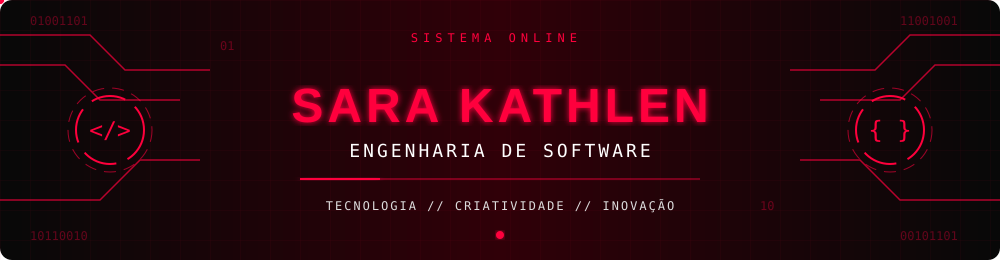

<div align="center">

<br>

<sub>⛤ TECNOLOGIA // CRIATIVIDADE // INOVAÇÃO ⛤</sub>

<br><br>


<br>


<br><br>

<a href="https://www.linkedin.com/in/sarakathlenqueirozdesouza-softwareengineering/">
  
</a>

<a href="mailto:sarakathlenqueiroz@gmail.com">
  
</a>

</div>


## ⛤ 01 // Sobre mim

Olá! Sou Sara Kathlen, estudante do terceiro semestre de Engenharia de Software, apaixonada por tecnologia, desenvolvimento de sistemas e criação de experiências digitais.

Acredito que desenvolver software vai além de escrever códigos. Envolve compreender problemas, estruturar soluções eficientes e criar experiências que unam funcionalidade, criatividade e identidade visual.

Durante minha trajetória acadêmica, venho aprimorando meus conhecimentos em programação, desenvolvimento web, estruturas de dados e organização de sistemas.

Valorizo códigos limpos, interfaces intuitivas, boas práticas de desenvolvimento e o aprendizado contínuo.

Atualmente, busco uma oportunidade de **estágio em Engenharia de Software ou Desenvolvimento Web**, na qual possa aplicar meus conhecimentos, colaborar com equipes e evoluir profissionalmente.

```python
class Desenvolvedora:
    def __init__(self):
        self.nome = "Sara Kathlen"
        self.curso = "Engenharia de Software"
        self.semestre = 3
        self.localizacao = "Brasil"
        self.status = "Em constante evolução"
        self.interesses = [
            "Desenvolvimento de Software",
            "Desenvolvimento Web",
            "Interfaces Criativas",
            "Estruturas de Dados",
            "Tecnologia e Inovação"
        ]
        self.disponivel_para_estagio = True

    def filosofia(self):
        return "Aprender. Criar. Evoluir."

sara = Desenvolvedora()
```


## ⛤ 02 // Tecnologias e ferramentas

<div align="center">

### Linguagens de programação e scripts


### Desenvolvimento Web


### Ferramentas de desenvolvimento


<br><br>


</div>


## ⛤ 03 // Áreas de interesse

<div align="center">


</div>


## ⛤ 04 // Aprendizado contínuo

```text
┌──────────────────────────────────────────────┐
│ SISTEMA DE DESENVOLVIMENTO PESSOAL            │
├──────────────────────────────────────────────┤
│ Lógica de programação       [EM EVOLUÇÃO]    │
│ Estruturas de dados         [EM EVOLUÇÃO]    │
│ Desenvolvimento Web         [EM EVOLUÇÃO]    │
│ Arquitetura de software     [EM EVOLUÇÃO]    │
│ Interfaces responsivas      [EM EVOLUÇÃO]    │
│ Git e GitHub                [EM EVOLUÇÃO]    │
│ Boas práticas de código     [EM EVOLUÇÃO]    │
├──────────────────────────────────────────────┤
│ STATUS: APRENDIZADO CONTÍNUO                  │
└──────────────────────────────────────────────┘
```

Meu objetivo é construir uma base técnica sólida e transformar o conhecimento acadêmico em soluções práticas, eficientes e relevantes.


## ⛤ 05 // Estatísticas do GitHub

<div align="center">


<br><br>


<br>


</div>


## ⛤ 06 // Monitor de contribuições

<div align="center">


<br>


</div>


## ⛤ 07 // Além do código

<div align="center">


<br><br>


<i>
"Programar não é apenas fazer algo funcionar.<br>
É transformar ideias em soluções com propósito."
</i>

<br><br>


<br><br>

**創造 • 技術 • 革新**

<sub>CRIATIVIDADE • TECNOLOGIA • INOVAÇÃO</sub>

</div>


## ⛤ 08 // Objetivos profissionais

Busco oportunidades que me permitam crescer na área de tecnologia, participar do desenvolvimento de soluções inovadoras e contribuir com equipes que valorizem a qualidade técnica, a criatividade e o aprendizado.

Tenho interesse em oportunidades de estágio nas áreas de Engenharia de Software e Desenvolvimento Web, nas quais possa desenvolver minhas competências, adquirir experiência prática e enfrentar novos desafios profissionais.

<div align="center">


</div>


## ⛤ 09 // Conexões profissionais

<div align="center">

```text
> Estabelecendo conexão...
> Canal de comunicação disponível.
> Aguardando novas oportunidades.
```

<br>

<a href="https://www.linkedin.com/in/sarakathlenqueirozdesouza-softwareengineering/">
  
</a>

<a href="mailto:sarakathlenqueiroz@gmail.com">
  
</a>

<br><br>


<br>

<sub>⛤ DESENVOLVIDO COM PROPÓSITO ⛤</sub>

<br>

<sub>© Sara Kathlen — 2026</sub>

</div>


